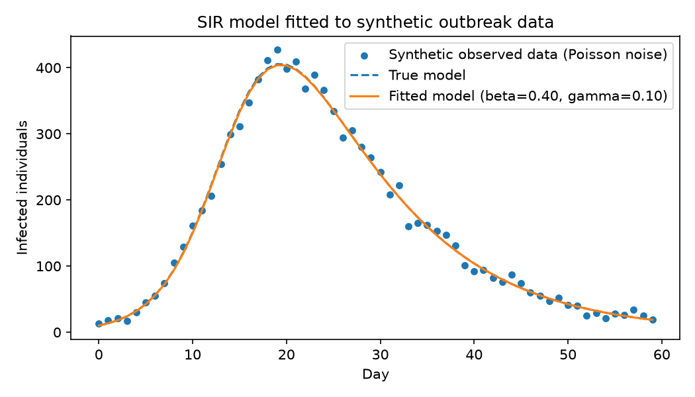

# sir-model-fitting
# Likelihood-based fitting of an SIR epidemic model

Mini-project in Python implementing the core workflow of infectious-disease modeling:

1. Simulated synthetic outbreak data from an SIR compartmental model.
2. Added Poisson observation noise to mimic real case-count data.
3. Estimated transmission (beta) and recovery (gamma) parameters by maximum likelihood using `scipy.optimize`.

**Tools:** Python (NumPy, SciPy, Matplotlib). The fitted parameters perfectly recovered the true values used to generate the data.

